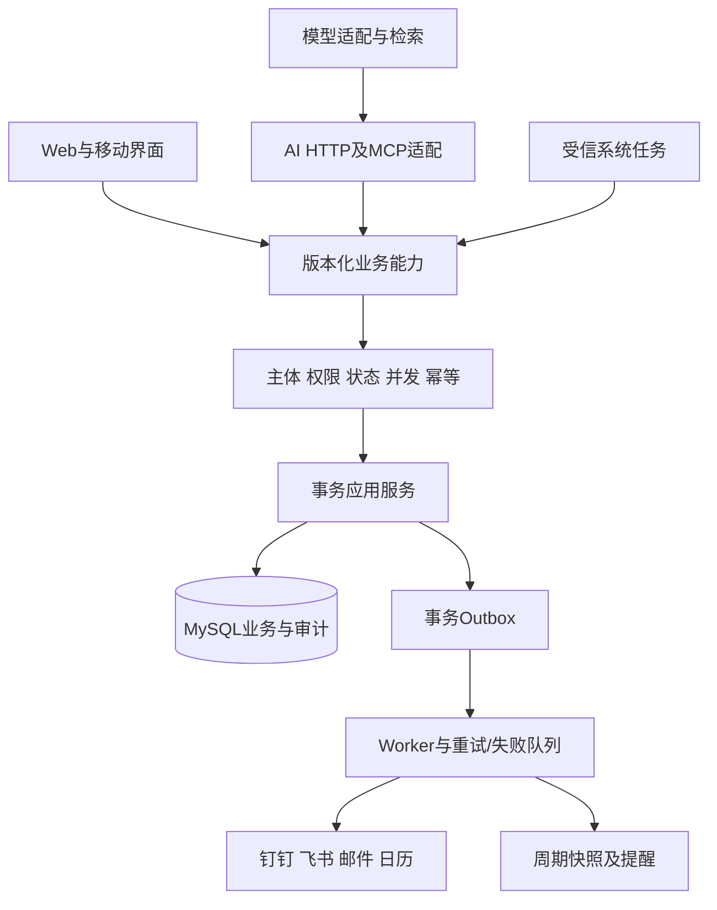

# 工程实施计划 v1.0

2026-11-15；设计候选。按现有React/Ant Design、NestJS、Prisma/MySQL和Node24推进；不因对标Salesforce更换框架或重写全部后端。所有计划功能均未在本轮实现。

## 1. 架构与执行边界

保留WorkspaceService已加固命令边界，按业务域逐步拆应用服务；不一次拆微服务。旧原型路由继续关闭，旧AI/预测代码先审查可复用逻辑，不能绕过现有guard重新开放。迁移API需契约兼容、调用方清单和弃用记录。系统主体只授权固定租户和能力，不能经HTTP/MCP伪造。

查询同样执行对象、字段和记录权限；列表、聚合、搜索、导出、AI取数共用规范化QuerySpec与权限过滤。报表使用受限DSL和预登记关系，不开放任意SQL。候选搜索cursor分页，记录详情投影有版本。

## 2. 数据设计增量

以下是概念模型，不是已执行DDL。名字和约束在对应PR结合现有schema最终确定；不重复创建现有对象。

|域|拟新增/扩展|关键约束|
|---|---|---|
|视图|SavedView、UserPreference、SearchIndex投影|租户/对象/owner/共享范围，发布版本；搜索命中仍实时验权|
|活动|Activity、ActivityLink、ActivityRevision|复用现有FollowUp/ActionPlan，先建立统一投影和显式链接；源表ID可追溯|
|客户/商机|OpportunityContactRole、SalesProcessVersion、StageRule、StageTransitionEvent|联系人角色归商机；规则快照；单调事件序列及前后值|
|交易|PriceBook/EntryVersion、PaymentScheduleTemplate/Line、PaymentTriggerEvent|价格/条款快照；精确金额；每触发事件仅生成一次计划|
|预测|ForecastPeriod、ForecastSubmission/Line、ForecastAdjustment、ForecastSnapshot|tenant+period+scope+revision唯一；锁定不可覆写|
|历史|OpportunityFieldChange、PipelineSnapshot/Line|记录金额、日期、状态、类别、归属快照；历史缺失标未知|
|配置|FieldDefinition、RecordType、LayoutVersion、ValidationRuleVersion|系统保留字段不可删；变更预演；旧实例保持引用版本|
|报表|ReportDefinition、MetricDefinition、DashboardLayout|目录白名单、字段权限、公式/口径版本、查询预算|
|自动化|AutomationVersion、OutboxEvent、JobExecution、DeliveryAttempt|事务内outbox；event+action去重；有限重试/死信；结果可查询|
|集成|ExternalConnection、IdentityBinding、SyncCursor、WebhookReceipt|凭证加密、scope、单租户、签名和幂等；不能用姓名自动绑定账号|
|AI|ModelProfile、SuggestionEvidence、SuggestionRevision、ModelUsage|复用已有委托/建议/执行表；证据版本、过期、成本与脱敏|
|迁移|ImportJob、ImportChunk、ImportRowResult、ExternalIdMap、OpeningBalanceEvent|按批和行去重；恢复进度；余额不得伪装成新收款|
|扩展|RenewalCase/Entitlement、Campaign/Member/Influence、Territory/Assignment、Cadence、PartnerGrant|M11专项模型；先核对既有原型表，避免同义双表|

保留旧schema字段不等于保留错误业务语义。stageHistory JSON先兼容读取，新事件规范化；禁止用旧updatedAt生成伪精确的历史变化。审计证据与业务分析事件职责分开。

## 3. 能力契约与接口清单

拟新增能力在已有目录登记ID、version、input/output、permission、effect、stateGuard、idempotency和evidence。下列名称为设计候选；若改变已有输入/效果使用主版本升级，不能静默改1.0。

- 查询：search.global、view.save/list、customer.timeline、opportunity.pipeline.query、opportunity.changes.query、forecast.read、report.run、import.status。
- 客户与活动：lead.convert、activity.record、activity.completeAndSchedule、contactRole.upsert、customer.merge.preview/execute。
- 商机：opportunity.stage.preview/advance、opportunity.close、opportunity.reopen；所有入口共用守卫，不由前端决定能否推进。
- 交易：quote.createVersion/selectVersion/render、paymentSchedule.preview/confirm、paymentTrigger.apply；金额服务器Decimal计算。
- 预测：forecast.submit/adjust/lock/revise；freeze使用受信系统主体或有权人工，不能临时伪造admin Actor。
- 配置：metadata.preview/publish、automation.preview/publish、report.save；执行表达式和关系均白名单。
- AI：customer.brief、meeting.extract、opportunity.suggestUpdate、suggestion.preview/approve/execute；委托凭证不能调用人工approve。
- 集成/迁移：connection.test、sync.preview/run、webhook.ingest、import.preview/start/retry；凭证管理、恢复和DB运维不暴露给普通智能体。

HTTP路径在域路由下表达上述能力，MCP是适配器。不要为每张表自动开放create/update/delete。长任务返回jobId、进度和回执链接；超时显示未知/执行中，使用相同requestKey查询，不盲目重新创建。

## 4. 迁移策略

采用expand→回填→核对→切换读写→保留兼容→确认后收缩。每批新迁移，不编辑已应用迁移。

- 阶段映射：导出旧stage/status组合，明确映射到新过程；won/lost和closedAt保持真实事实。交付状态映射到项目投影，不修改已有合同关系；未知阶段进入人工核对队列。
- 回款计划：新合同启用结构化条款；旧合同保留原计划，输出条款/总额/核销差异。已核销对象必须通过修订与补偿路径处理，不能直接删旧计划。
- 活动：先聚合旧跟进与行动为只读统一时间线，再按新服务写；每条有sourceType/sourceId唯一映射，禁止重复显示/重复计数。
- 权限：现有四角色建立等价权限快照后再启用配置权限集；跨人/团队/租户的回归矩阵必须一致，新增字段默认不暴露。
- 正式企业导入：演示数据保持独立；期初余额先对账、再经人工确认建立迁移事件；整批失败或部分成功策略在预演时锁定。

每次升级先加密备份，迁移副本演练、记录行数/金额/Hash与可恢复证据。回滚应用只适用于仍兼容旧schema的版本；不可逆数据迁移发生后用补偿或新库恢复再核对切换，不承诺“一条命令无损降级”。

## 5. 分批工程计划

每批一个可演示结果，按需拆多个PR；M11是多个专项子里程碑，不能一个巨型PR。负责人分工：Codex执行设计细化、实现、测试、文档与GitHub PR；产品负责人做业务验收；企业应用管理员提供测试授权；真实试用者执行可用性验收。工程复核可先用自查与CI，不等同独立第三方审计。

|批次|目标|依赖|需求|初步工程人日|出口|
|---|---|---|---|---|---|
|M0|修复业务与确立基线|无|F10/F17/F18/F29/F48|3–5|修复状态、漏斗、回款；真实数据差异预览；基线测量|
|M1|外壳、视图及权限接缝|M0|F01/F02/F03/F26/F28|4–6|全局搜索、保存视图、分页查询、四角色外壳|
|M2|活动与移动主线|M1|F07/F08/F37|4–7|统一时间线、下一步任务、手机跟进|
|M3|客户与线索|M1/M2|F04/F05|5–8|客户360、线索匹配转化、查重与协作|
|M4|商机工作区与销售方法|M2/M3|F06/F09/F10/F12|6–10|联系人角色、Path、版本化门槛、结束及历史|
|M5|报价合同与履约连续操作|M0/M3/M4|F15/F16/F17/F18/F25/F47|6–10|价目表、多报价、结构化分期、保留下游历史|
|M6|管道检查和预测|M4/M5|F11/F12/F13/F14/F29|6–10|周期快照、风险、预测提报与锁定修订|
|M7|配置、报表与细粒度权限|M1/M4/M6|F20/F21/F22/F23/F26|8–14|受限报表DSL、字段/布局配置、权限预演|
|M8|自动化和真实集成|M0/M2/M7|F24/F30/F36/F46|7–12|outbox/worker、触发规则、授权、回调和真实联调|
|M9|AI业务助手及能力扩展|M2/M4/M8|F31/F32/F33/F34|7–12|模型适配、证据与建议、审批执行、评测|
|M10|数据迁移和本地交付|M5/M6/M7/M8|F27/F28/F38/F46|5–8|分块导入、外部ID、期初对账、非空升级恢复|
|M11|完整销售扩展|M5/M6/M7/M8/M9/M10|F19/F35/F39/F40/F41/F42/F43/F44/F45|15–30|先补专项设计，再分续费/活动/区域/节奏/伙伴/CPQ子批交付|
|M12|整体可用性与商用候选验收|M0—M11|F37/F38/F47/F48及全矩阵|5–8|角色端到端、性能容量、权限、恢复和试运行证据|

表内基础版本工作项粗估合计81—140工程人日，分批滚动估算。M11数值仅涵盖专项设计与有限首版，不构成Salesforce高级CPQ、伙伴生态、区域治理等全部同深度能力的总工期；这些能力的最终深度和完整投入尚未确定，必须专项估算后纳入后续排期。

人日为初步工程投入估计，含设计细化、实现、测试和文档，非AI墙钟时间、非合同报价和交付承诺；未知团队容量及专项深度影响很大，M0实测后重估。不把早期“一天做演示”的目标外推为完整商用Salesforce能力可一天交付。日历排期依据每批出口及实际可用产能滚动确定。

### 下一批具体任务 M0

1. 新建fix分支；为看板lost标签、open漏斗口径、分期金额/触发规则建立独立反例。
2. 定义指标字典：开放管道、赢单、合同额、收款、核销、应收、逾期；前后端共用状态命名。
3. 明确新合同付款模板与旧合同差异预演；不自动重算历史核销。
4. 在隔离MySQL中验证迁移、幂等、并发、故障回滚和旧数据保留。
5. 浏览器用销售/主管/老板核对看板和合同主线，留截图及操作结果；记录基线任务时间。
6. 跑pnpm check及相关数据库/安装检查，更新PROGRESS、手册、CHANGELOG；提交PR并等待实际CI结果。
7. 产品负责人验收后再合并/部署。当前用户只要求设计文档，本轮不执行M0业务改造。

## 6. 检查与GitHub同步

每个较大改进：feature/fix分支→实现及必要测试→类型/lint/单元/构建→独立MySQL业务/迁移检查→浏览器任务→安装/恢复相关检查→文档与证据→推送PR→核对SHA和CI→产品验收→发布及本地升级。未合并分支、main、候选包和运行版本分开展示。

文档批次只跑链接、编号、矩阵覆盖、HTML/JS和敏感信息检查；不为无代码变更反复运行全部业务测试。后续功能批次按仓库要求pnpm check，不把HTTP fixture当真实数据库证据。公共GitHub不含凭证、业务原文、真实客户或备份。

## 7. 风险与处理

|风险|触发与影响|处理|责任及残余|
|---|---|---|---|
|范围增长|“全部”不断扩展到其他云|F矩阵版本管理、新需求单独编号和排期|产品负责人；P3仍需专项研究|
|历史数据不完整|旧阶段/金额变化无法回推|保留原值、标未知、生成差异报告|工程/业务共同核对，无法还原的历史不伪造|
|元数据复杂|页面配置绕过服务端规则|业务规则与布局分离、白名单和版本测试|工程；复杂自定义对象分期|
|外部凭证缺失|无法证明免登/回调真实可用|先实现模拟协议和失败路径，真实联调保留未验收|企业管理员；不能用假成功出货|
|AI错误/注入|误认人物日期、越权或误写|来源、结构化校验、最小权限、人审、评测与关闭开关|工程/业务；模型不可保证零错误|
|外发重复/漏发|网络超时未知状态|outbox、服务方幂等、回执核对、失败人工处理|工程；不承诺跨平台exactly-once|
|查询增长|全量findMany/前100条截断|统一服务端查询与聚合，按压测找索引/查询预算|工程；无实测不报容量|
|恢复不兼容|DB升级与旧包冲突|版本清单、兼容窗口、隔离恢复和切换演练|运维；RPO/RTO待测定|

## 8. 本地部署形态

保留演示与正式Compose项目/卷/配置隔离；安装只创建空企业及管理员。API/Web、MySQL、Worker必需性按批引入，Redis是否必需在M8用实际任务负载决策，不因为画图自动加入运维负担。证据附件保留现有受限存储，容量/对象存储扩展做迁移方案；不要在未知容量下承诺大文件。版本页展示Git SHA、schema迁移状态、模式和最近备份检查，不显示密钥。升级包附操作手册、校验清单和对应SHA。
